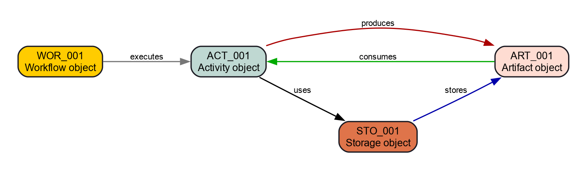
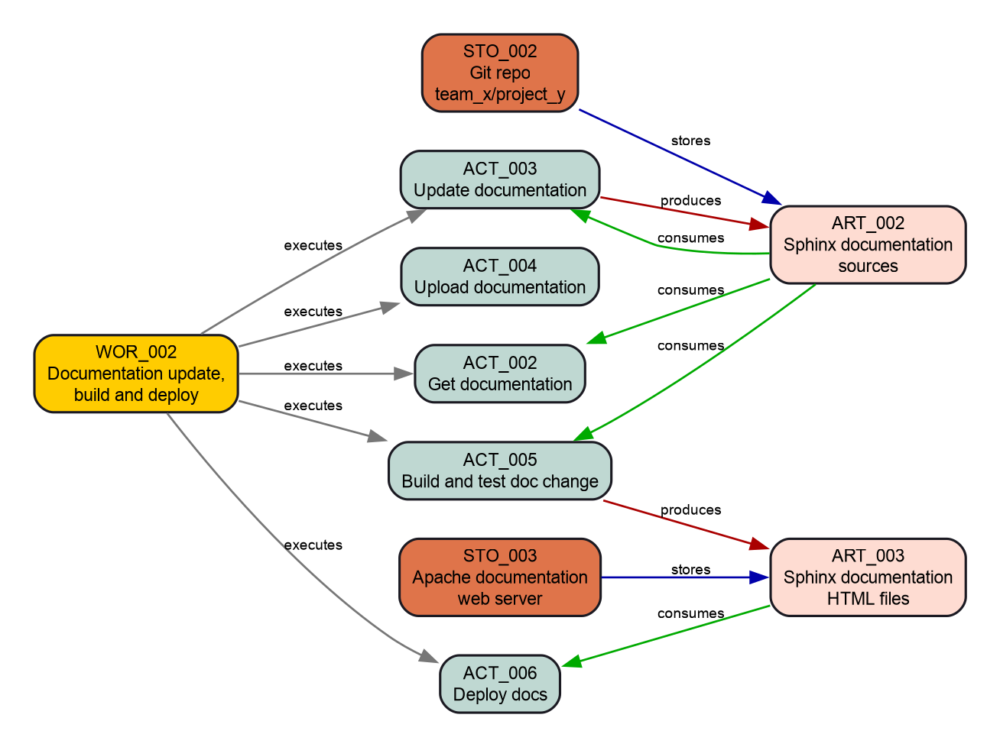

In vielen Unternehmen ist Prozessdokumentation eine eigene Aufgabe: Ein eigenes Team für Prozesse, Methoden und Tools (PMT) kümmert sich darum und veröffentlicht sie in Formaten, die Projektdokumentation weder wiederverwenden noch referenzieren kann. Dabei würde es Entwicklern helfen, Projektanforderungen mit Prozessschritten zu verlinken – sie würden besser verstehen, warum es eine Anforderung gibt.

Dieser Beitrag zeigt, wie sich Prozesse und Workflows mit dem Docs-as-Code-Ansatz dokumentieren lassen.

Prozessbeschreibungen sind meist nicht sehr detailliert. Sie sind unabhängig von Tools, und es ist Aufgabe des Projektteams, die Tools festzulegen und die übergeordneten Prozesse in toolspezifische Workflows herunterzubrechen.

Dafür ist es sinnvoll, die Informationen aller Ebenen der Prozessdefinition in einer Dokumentation zu haben. Dann lässt sich alles verlinken und referenzieren und wird von Ebene zu Ebene projektspezifischer.

## Prozessmodell

Das Modell hier ist vereinfacht; so wird es in Entwicklungsabteilungen eines deutschen Automobilunternehmens genutzt. Es hat diese Elemente:

- **Workflow:** eine Folge von Aktivitäten, die in bestimmter Reihenfolge ausgeführt werden müssen, um das gewünschte Ergebnis zu erreichen.
- **Aktivität:** eine atomare Aufgabe, die in verschiedenen Workflows vorkommen kann.
- **Artefakt:** eine Ressource, die Aktivitäten als Eingabe nutzen oder als Ergebnis erzeugen.
- **Ablage:** der Ort, an dem eine Ressource liegt oder abgelegt werden muss.

Zwischen den Elementen gibt es Beziehungen:

- Ein **Workflow**
  - hat eine oder mehrere Aktivitäten,
  - kann dieselbe Aktivität mehrfach nutzen,
  - kann mehrere Ablagen haben,
  - braucht die Artefakte, die seine Aktivitäten festlegen.
- Eine **Aktivität**
  - wird von einem oder mehreren Workflows genutzt,
  - nutzt 0–n Artefakte als Eingabe oder Ausgabe,
  - nutzt Ablagen des Workflows oder eigene.
- Ein **Artefakt**
  - kann von 0–n Aktivitäten genutzt werden,
  - hängt nicht an einer Ablage (das legt der Workflow oder die Aktivität fest).
- Eine **Ablage**
  - wird von einem Workflow oder einer Aktivität festgelegt oder genutzt.

## Das Modell konfigurieren

Wir konfigurieren Sphinx-Needs mit diesen **Need-Typen**:

```python
needs_types = [
    dict(directive="wor", title="Workflow", prefix="W_", color="#FFCC00", style="node"),
    dict(directive="act", title="Activity", prefix="ACT_", color="#BFD8D2", style="node"),
    dict(directive="art", title="Artifact", prefix="ART_", color="#FEDCD2", style="node"),
    dict(directive="sto", title="Storage", prefix="STO_", color="#DF744A", style="node"),
]
```

Die verschiedenen Objekte sollen **leicht zu unterscheiden** sein, also bekommen sie einen farbigen Rahmen:

```python
needs_global_options = {
    'style': [
        ('yellow_border', 'type == "wor"'),
        ('green_border', 'type == "act"'),
        ('red_border', 'type == "art"'),
        ('blue_border', 'type == "sto"'),
    ]
}
```

Außerdem soll jedes Need eine ID haben, und jede ID soll mit einem bestimmten Präfix und einer Nummer beginnen:

```python
needs_id_required = True

# Must start with WOR, ACT, ART or STO, followed by "_" and at least 3 digits, e.g. ART_143
needs_id_regex = r'^(WOR|ACT|ART|STO)_[\d]{3,}'
```

Die Beziehungen sind beschrieben, also legen wir passende Link-Typen an:

```python
needs_extra_links = [
    {
        # workflow -> activity
        "option": "executes",
        "incoming": "is executed by",
        "outgoing": "executes",
        "style": "#777777",
    },
    {
        # activity -> artifact
        "option": "produces",
        "incoming": "is produced by",
        "outgoing": "produces",
        "style": "#AA0000",
    },
    {
        # activity <- artifact
        "option": "consumes",
        "incoming": "is consumed by",
        "outgoing": "consumes",
        "style": "#00AA00",
        "style_start": "<-",
        "style_end": "-",
    },
    {
        # storage -> artifact
        "option": "stores",
        "incoming": "stored inside",
        "outgoing": "stores",
        "style": "#0000AA",
    },
    {
        # workflow/activity -> storage
        "option": "uses",
        "incoming": "used by",
        "outgoing": "uses",
        "style": "#000000",
    },
]
```

## Das Modell dokumentieren

Mit dieser Konfiguration beschreiben wir unser Modell in Sphinx-Needs:

```rst
.. wor:: Workflow object
   :id: WOR_001
   :executes: ACT_001
   :tags: post_process

   Defines a collection of activities, which must be performed in a specific order to get the needed result.

.. act:: Activity object
   :id: ACT_001
   :uses: STO_001
   :consumes: ART_001
   :produces: ART_001
   :tags: post_process

   Atomic task description, which can be used in different workflows.

.. art:: Artifact object
   :id: ART_001
   :tags: post_process

   Some resource, which can be used as input for or output by activities.

.. sto:: Storage object
   :id: STO_001
   :tags: post_process
   :stores: ART_001

   The location of a resource where it can be accessed or must be stored.
```

Die ursprüngliche Fassung dieses Beitrags wurde mit Sphinx gebaut und zeigte das Ergebnis live. So sah es aus:

<div class="need" style="border-left-color:#FFCC00">
  <div class="need-head"><span class="need-type">Workflow</span> <strong>Workflow object</strong> <code>WOR_001</code></div>
  <div class="need-meta">executes: ACT_001</div>

Defines a collection of activities, which must be performed in a specific order to get the needed result.

</div>

<div class="need" style="border-left-color:#BFD8D2">
  <div class="need-head"><span class="need-type">Aktivität</span> <strong>Activity object</strong> <code>ACT_001</code></div>
  <div class="need-meta">uses: STO_001 · consumes: ART_001 · produces: ART_001</div>

Atomic task description, which can be used in different workflows.

</div>

<div class="need" style="border-left-color:#FEDCD2">
  <div class="need-head"><span class="need-type">Artefakt</span> <strong>Artifact object</strong> <code>ART_001</code></div>
  <div class="need-meta"></div>

Some resource, which can be used as input for or output by activities.

</div>

<div class="need" style="border-left-color:#DF744A">
  <div class="need-head"><span class="need-type">Ablage</span> <strong>Storage object</strong> <code>STO_001</code></div>
  <div class="need-meta">stores: ART_001</div>

The location of a resource where it can be accessed or must be stored.

</div>

Sieht gut aus. Und so sieht es grafisch aus:

```rst
.. needflow::
   :tags: post_process
   :show_link_names:
```



## Den Prozess absichern

Sphinx-Needs erlaubt reguläre Ausdrücke für Need-IDs und zusätzliche Link-Typen. Diese Einstellungen gelten aber nicht nur für bestimmte Need-Typen. Ich könnte also ein Need vom Typ **Workflow** mit der ID **ART_123** anlegen und den Link-Typ **stores** nutzen.

Mit `needs_warnings` geben wir Warnungen aus, wenn solche internen Regeln verletzt werden:

```python
needs_warnings = {
    # Check for wrong ID prefixes
    'workflow_with_wrong_prefix': "type == 'wor' and not id.startswith('WOR_')",
    'activity_with_wrong_prefix': "type == 'act' and not id.startswith('ACT_')",
    'artifact_with_wrong_prefix': "type == 'art' and not id.startswith('ART_')",
    'storage_with_wrong_prefix': "type == 'sto' and not id.startswith('STO_')",
    # Check for wrongly used links
    'workflow_with_wrong_link_types': "type == 'wor' and any([produces, consumes, stores, uses])",
    'activity_with_wrong_link_types': "type == 'act' and any([executes, stores])",
    'artifact_with_wrong_link_types': "type == 'art' and any([executes, produces, consumes, stores, uses])",
    'storage_with_wrong_link_types': "type == 'sto' and any([executes, produces, consumes, uses])",
}
```

Ein Verstoß gegen unsere Prozessregeln sieht in der Konsole so aus:

```text
Checking sphinx-needs warnings
workflow_with_wrong_prefix: passed
workflow_with_wrong_link_types: failed
        failed needs: 1 (WOR_001)
        used filter: type == 'wor' and any([produces, consumes, stores, uses])
WARNING: Sphinx-Needs warnings were raised. See console / log output for details.
```

Baust du mit `sphinx-build`, kannst du die Option `-W` setzen. Dann gelten alle Warnungen als Fehler, und der Build bricht ab.

In einem CI-Build verhindert das, dass jemand Dokumentation integriert, die nicht zum Prozess passt.

## Ein besseres Prozessmodell

Natürlich ist dieses Modell nicht vollständig und folgt keinem Standard.

Ein wichtiger Punkt fehlt noch: zusätzliche Optionen, etwa eine „Rolle“, die eine Aktivität ausführt, oder ein „Artefakttyp“ wie „Dokument“ oder „Binärdatei“.

Ein paar Ideen:

- Weitere **Need-Typen**:
  - **Mitarbeiter:** Personen Aktivitäten zuordnen oder Verantwortung klären.
  - **Prozess** und **Prozessschritt:** eine Ebene über den Workflows.
- Weitere **Need-Optionen**:
  - **Dauer:** Zeitfenster für eine Aktivität.
  - **Pfad/URL:** Ort einer Ablage.
  - **Name:** Namensschema für ein Artefakt.
- Weitere **Link-Typen**:
  - **Mitarbeiter:** Link auf ein Need vom Typ „Mitarbeiter“.
  - **Abteilung:** Link auf ein Need vom Typ „Abteilung“.
  - **Tools:** Links auf die Tools, die eine Aktivität nutzt.

Es gibt also viel Luft nach oben.

## Beispiel

Das Modell ist konfiguriert, jetzt können wir damit spielen. Wir beschreiben einen *Workflow zum Aktualisieren und Bauen der Dokumentation*.

### Workflows

Ein kleines Beispiel, also nur ein Workflow:

<div class="need" style="border-left-color:#FFCC00">
  <div class="need-head"><span class="need-type">Workflow</span> <strong>Documentation update, build and deploy</strong> <code>WOR_002</code></div>
  <div class="need-meta">führt aus: ACT_002, ACT_003, ACT_004, ACT_005, ACT_006</div>

Describes how to update our project handbook and what build and deployment look like.

</div>

### Ablagen

Wir brauchen einen Ort für die Quelldateien und die fertige HTML-Dokumentation:

<div class="need" style="border-left-color:#DF744A">
  <div class="need-head"><span class="need-type">Ablage</span> <strong>Git repo github.company.com/team_x/project_y</strong> <code>STO_002</code></div>
  <div class="need-meta">stores: ART_002</div>

All files for project Y are available at github.company.com/team_x/project_y.

</div>

<div class="need" style="border-left-color:#DF744A">
  <div class="need-head"><span class="need-type">Ablage</span> <strong>Apache documentation web server</strong> <code>STO_003</code></div>
  <div class="need-meta">stores: ART_003</div>

Stores all HTML documentation.

</div>

### Artefakte

Unser Workflow arbeitet mit diesen Artefakten:

<div class="need" style="border-left-color:#FEDCD2">
  <div class="need-head"><span class="need-type">Artefakt</span> <strong>Sphinx documentation sources</strong> <code>ART_002</code></div>
  <div class="need-meta"></div>

All data inside `/docs/` of the project files.

</div>

<div class="need" style="border-left-color:#FEDCD2">
  <div class="need-head"><span class="need-type">Artefakt</span> <strong>Sphinx documentation HTML files</strong> <code>ART_003</code></div>
  <div class="need-meta"></div>

The generated, final documentation as HTML pages.

</div>

### Aktivitäten

Und schließlich die Aktivitäten, die der Workflow braucht:

<div class="need" style="border-left-color:#BFD8D2">
  <div class="need-head"><span class="need-type">Aktivität</span> <strong>Get documentation</strong> <code>ACT_002</code></div>
  <div class="need-meta">role: developer · consumes: ART_002</div>

Use `git` to clone the project files.

</div>

<div class="need" style="border-left-color:#BFD8D2">
  <div class="need-head"><span class="need-type">Aktivität</span> <strong>Update documentation</strong> <code>ACT_003</code></div>
  <div class="need-meta">needs: ACT_002 · consumes: ART_002 · produces: ART_002</div>

Use the IDE PyCharm to change the files under `/docs/`.

</div>

<div class="need" style="border-left-color:#BFD8D2">
  <div class="need-head"><span class="need-type">Aktivität</span> <strong>Upload documentation</strong> <code>ACT_004</code></div>
  <div class="need-meta">role: developer · needs: ACT_003</div>

Use `git push` to upload all commits that include the documentation changes.

</div>

<div class="need" style="border-left-color:#BFD8D2">
  <div class="need-head"><span class="need-type">Aktivität</span> <strong>Build and test doc change</strong> <code>ACT_005</code></div>
  <div class="need-meta">role: CI · needs: ACT_004 · consumes: ART_002 · produces: ART_003</div>

Builds the documentation and runs some checks on it.

</div>

<div class="need" style="border-left-color:#BFD8D2">
  <div class="need-head"><span class="need-type">Aktivität</span> <strong>Deploy docs</strong> <code>ACT_006</code></div>
  <div class="need-meta">role: CI · needs: ACT_005 · consumes: ART_003</div>

Deploys the documentation to STO_003.

</div>

### Kennzahlen und Probleme

Alle Zahlen, Tabellen und Diagramme unten erzeugt Sphinx-Needs aus den Objekten oben.

```rst
The numbers here are for :need:`WOR_002`,
which includes :need_count:`type=="act" and "post_process_example" in tags`
activities and :need_count:`type=="art" and "post_process_example" in tags` artifacts,
stored on :need_count:`type=="sto" and "post_process_example" in tags` storages.
```

Ergebnis: Die Zahlen gelten für WOR_002 mit 5 Aktivitäten und 2 Artefakten in 2 Ablagen.

Das Diagramm des gesamten Workflows:

```rst
.. needflow::
   :tags: post_process_example
   :show_link_names:
```



Eine Tabelle mit allen Objekten:

```rst
.. needtable::
   :tags: post_process_example
   :columns: id, title, type_name, role
```

| ID | Titel | Typ | Rolle |
|---|---|---|---|
| WOR_002 | Documentation update, build and deploy | Workflow | |
| STO_002 | Git repo github.company.com/team_x/project_y | Ablage | |
| STO_003 | Apache documentation web server | Ablage | |
| ART_002 | Sphinx documentation sources | Artefakt | |
| ART_003 | Sphinx documentation HTML files | Artefakt | |
| ACT_002 | Get documentation | Aktivität | developer |
| ACT_003 | Update documentation | Aktivität | |
| ACT_004 | Upload documentation | Aktivität | developer |
| ACT_005 | Build and test doc change | Aktivität | CI |
| ACT_006 | Deploy docs | Aktivität | CI |

#### Kennzahlen

```rst
.. needpie:: Comparison of used need types
   :shadow:
   :labels: Workflow, Activity, Artifact, Storage

   type=="wor" and "post_process_example" in tags
   type=="act" and "post_process_example" in tags
   type=="art" and "post_process_example" in tags
   type=="sto" and "post_process_example" in tags
```

| Need-Typ | Anzahl |
|---|---|
| Workflow | 1 |
| Aktivität | 5 |
| Artefakt | 2 |
| Ablage | 2 |

```rst
Overall :need_count:`type=="act" and role=="developer" ? type=="act"` % of activities are done by **developer**.
And :need_count:`type=="act" and role=="CI" ? type=="act"` % by **CI**.
```

Ergebnis: Insgesamt werden 33,3 % der Aktivitäten von **developer** erledigt und 33,3 % von **CI**.

Warum ergibt das nicht 100 %? Siehe die Probleme unten.

#### Probleme

```rst
**Activities** without a set role: :need_count:`type=="act" and not role and "post_process_example" in tags`

.. needtable::
   :filter: type=="act" and not role and "post_process_example" in tags
   :style: table
   :columns: id, title, needs, role
```

Ergebnis: **Aktivitäten** ohne Rolle: 1

| ID | Titel | Needs | Rolle |
|---|---|---|---|
| ACT_003 | Update documentation | ACT_002 | |

## Zum Schluss

Ich hoffe, das Beispiel und die Konfiguration helfen dir bei deinen eigenen Anwendungsfällen und geben dir einen Eindruck von Sphinx-Needs und seinen Features.

Die Konfiguration lässt sich leicht erweitern, um ein Softwareentwicklungsprojekt zu dokumentieren. Sphinx-Needs unterstützt von Haus aus Anforderungen, Spezifikationen und Testfälle – und mit der Konfiguration oben kannst du Software-Anforderungen mit Aktivitäten und anderen Prozesselementen verlinken.
