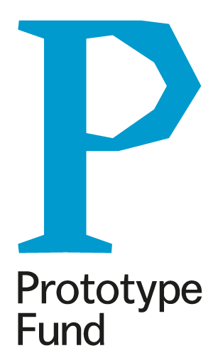

The [Prototype Fund](https://prototypefund.de/) supports and finances Open-Needs-DB from March to September 2022.

The [Federal Ministry of Education and Research](https://www.bmbf.de/bmbf/en/home/home_node.html) created this program to support developers in Germany in building digital prototypes for civic tech, data literacy, IT security and software infrastructure.

Open-Needs-DB will be a REST-based database for requirements and similar objects. It does not provide one single user interface; instead it supports building interfaces in different tools and areas. Currently planned are:

- **Web app:** a simple React application to create and show elements of the database.
- **Sphinx-Needs:** read needs from, or import them into, a Sphinx project from an Open-Needs-DB.
- **VS Code plugin:** get information about existing needs while writing needs-based content in Sphinx and other documentation projects.

The goal of Open-Needs-DB is to share requirements and similar objects between projects, and to make suggestions based on a comparison between a target project and related projects.

Development may start a little earlier than March 2022, mainly because the Sphinx-Needs community urgently needs a central service to store and maintain requirements in bigger projects.

We plan to use the following technologies:

- [FastAPI](https://fastapi.tiangolo.com/)
- [SQLModel](https://sqlmodel.tiangolo.com/)
- [React](https://reactjs.org/)
- [Python Language Server](https://github.com/palantir/python-language-server)

## Our application

If you want to know what our application looked like, here it is. It was written in German, and I kept it that way.

**Projekttitel:** Open Needs DB

**Beschreibe dein Projekt kurz.**

Die „Open Needs DB“ ist eine Datenbank für Anforderungen, Spezifikationen und ähnliche Objekte.

Sie soll bei der sauberen, umfassenden und sicheren Erstellung von Anforderungen und Co. in Projektdokumentationen unterstützen.

Das Projekt soll im Rahmen des Open-Source-Projektes „Sphinx-Needs“ umgesetzt werden, welches sich um die Erstellung und Verwaltung von Anforderungen in Dokumentation nach dem Docs-as-Code-Ansatz kümmert.

„Open Needs DB“ soll inhaltlich bei der Erstellung unterstützen, indem ähnliche Anforderungen aus anderen Projekten als Beispiel dienen oder auf fehlende Details hingewiesen wird. Neben einer API soll auch eine Extension für VS Code bereitgestellt werden.

**Welchem gesellschaftlichen Themenfeld ordnest du dein Projekt zu?**

Sicherheit

**Welche gesellschaftliche Herausforderung willst du mit dem Projekt angehen?**

Softwareprojekte so zu entwickeln, dass diese sicher sind, wird bei der heute notwendigen Komplexität immer schwieriger. Oft ist bei Themen wie Datensicherheit oder auch Sicherheit für Leib und Leben ein Expertenwissen notwendig, welches häufig nicht zur Verfügung steht.

Hinzu kommt die oft notwendige Dokumentation und die Erbringung von Nachweisen, dass diese Projekte nach einem akzeptierten Standard entwickelt wurden.

Da die Dokumentation z. B. von Anforderungen zu den eher ungeliebten Tätigkeiten von SW-Entwickler/innen gehört, wird diese oft vernachlässigt oder bei Budget- und Zeitknappheit stark beschnitten.

Leider sind Anforderungen und ähnliche Objekte selten durch eine API zugänglich oder so aufbereitet, dass diese technisch auswertbar und wiederverwendbar sind. Dadurch erschwert sich für diese Art von Informationen ein offener Austausch, wie er sonst schon gelebt wird (z. B. SW-Bibliotheken).

All dies erschwert SW-Teams weltweit die sichere Entwicklung ihrer Lösungen. Und vor allem Open-Source-Projekte leiden aufgrund der knappen Zeit ihrer Community stark darunter.

„Open Needs DB“ soll es ermöglichen, dass Projekte passende Anforderungen und Co. einfach und schnell von anderen Projekten übernehmen können, um eine sichere Entwicklung zu gewährleisten.

**Welchem technischen Themenfeld ordnest du dein Projekt zu?**

Anwendungen

**Wie willst du dein Projekt technisch umsetzen?**

Das schon vorhandene Projekt „Sphinx-Needs“ stellt die Funktionen zur Erstellung von Anforderungen und für deren Export in eine JSON-Datei zur Verfügung.

„Open Needs DB“ wird einen Importer für diese JSON-Datei anbieten, um die Daten in eine dokumentenbasierte DB (MongoDB oder ElasticSearch) zu übernehmen.

Ein Full-Text-Search-Server wird diese Daten indizieren und die Suche nach Keywords oder Text-Ähnlichkeiten ermöglichen. Als technische Lösung hierfür kann ElasticSearch oder Sphinx-Search dienen.

Eine einfache webbasierte Oberfläche (Flask) soll eine erste Suche ermöglichen. Flask und zugehörige Plugins sollen auch für die Bereitstellung einer REST-API dienen, die die Integration der Suche in andere Anwendungen ermöglicht.

Als erste externe Integration soll ein Plugin für die Entwicklungsumgebung VS Code erstellt werden, um die Daten der „Open Needs DB“ direkt bei der Erstellung von Anforderungen mit „Sphinx-Needs“ nutzen zu können.

Weitere Ideen wie der Betrieb einer frei zugänglichen „Open Needs DB“-Instanz, bei der sich Projekte mit ihren Anforderungen (needs.json-URLs) registrieren können, sind interessant, aber ein langfristiges Thema und daher kein Ziel innerhalb des geförderten Projektzeitraumes.

**Hast du schon an der Idee gearbeitet? Wenn ja, beschreibe kurz den aktuellen Stand und erkläre die geplanten Neuerungen.**

Für die Idee „Open Needs DB“ wurden bis jetzt nur Konzepte skizziert und ein erster Importer für Daten aus einer „needs.json“ nach ElasticSearch entwickelt.

Das prozesstechnisch vorgelagerte Open-Source-Projekt „Sphinx-Needs“ existiert seit über 4 Jahren und wurde durch mich gegründet. Auch heute noch bin ich der Haupt-Maintainer der Software.

„Sphinx-Needs“ ist schon produktiv und wird weltweit eingesetzt. Öffentlich z. B. von der Organisation [ONAP](https://www.onap.org/), einem Projekt der Linux Foundation. Vor allem aber wird es von zahlreichen Unternehmen intern eingesetzt. Namentlich sind hier Projekte von OEM- und Tier-1-Unternehmen der Automobilbranche bekannt.

**Link zum bestehenden Projekt (falls vorhanden)**

<https://sphinxcontrib-needs.readthedocs.io/en/latest/>

**Welche ähnlichen Ansätze gibt es schon und was wird dein Projekt anders bzw. besser machen?**

Es gibt kommerzielle Requirement-Tools, die hauptsächlich über grafische User-Interfaces benutzt werden müssen. Ein Ansatz, der vor allem den Docs-as-Code-Ansatz verfolgt und dessen erstellte Daten frei verteilt und wiederverwendet werden können, ist nicht bekannt.

**Wer ist die Zielgruppe und wie soll dein Projekt sie erreichen?**

Zielgruppe sind Entwickler, Projektmanager und Ingenieure, die in kommerziellen, akademischen oder öffentlichen Projekten Dokumentationen für Anforderungen und Spezifikationen pflegen oder auch nur lesen müssen.

Dank der engen Verzahnung mit „Sphinx-Needs“ kann auf eine existierende Community aufgebaut werden, sodass der Kontakt zu ersten Anwendern gesichert ist.

Auch der Kontakt in die Industrie existiert, sodass „Open Needs DB“ auch als unternehmensinterne Instanz schnell zum Einsatz kommen könnte. Anfragen zu ähnlichen Funktionen gab es bei „Sphinx-Needs“ schon öfters.

**An welchen Softwareprojekten hast du / habt ihr bisher gearbeitet?**

Marco und ich sind seit 10 Jahren Tool-Entwickler und erstellen alles von Skripten für CI-Systeme bis zu Web-Apps für Geschäftsdaten.

Im Open-Source-Umfeld:

- [Sphinx-Needs](https://github.com/useblocks/sphinxcontrib-needs)
- [Sphinx-Test-Reports](https://github.com/useblocks/sphinx-test-reports): importiert Testergebnisse, stellt sie über Sphinx-Needs in Dokumentationen dar und macht sie verlinkbar, z. B. mit Spezifikationen.

Ansonsten kommen immer mal wieder Bug-Reports und Bugfixes in diversen Open-Source-Projekten vor.

**Bewerbt ihr euch als Team um die Förderung?**

Ja – Daniel Woste und Marco Heinemann.

**Wie viele Stunden wollt ihr in den 6 Monaten Förderzeitraum insgesamt an der Umsetzung arbeiten?**

980

**Skizziere kurz die wichtigsten Meilensteine, die im Förderzeitraum umgesetzt werden sollen.**

1. Auswahl einer DB für die Needs-Dokumente und eines Text-Search-Servers
2. Erstellung eines Importer-Skriptes
3. Festlegung und Umsetzung von zusätzlichen Text-Klassifizierungen (z. B. Keyword-Stärke)
4. Erstellung einer REST-API
5. Umsetzung einer kleinen Web-App zur Anzeige und Suche
6. Erstellung einer VS-Code-Extension
7. Erweiterung von „Sphinx-Needs“ zur Einbindung einer „Open Needs“-Instanz (für Need-Imports oder Need-Verlinkung), falls die Zeit reicht

