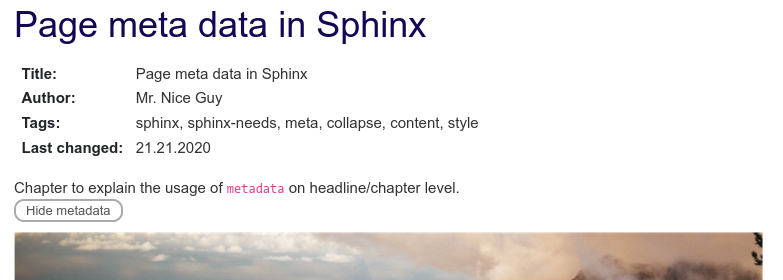

In bigger Sphinx projects, written by hundreds of authors, you often need to store additional data to keep the creation and update of pages under control.

This data can be stored and maintained as metadata at the top of each rst file.

The main questions about a page are often:

- Who is responsible?
- Who made the last change?
- When was the last change?
- What is the content or goal of the page (short excerpt)?
- What is the status? Still a draft?
- Is there any critical content? Internal use only?

You can answer these questions on the page itself, as part of the normal content. But that usually doesn't look nice, and the information can't be reused.

A better approach is [Sphinx-Needs](https://sphinx-needs.com), which lets you place a need object at the beginning of each page. This object is highly configurable and can be shown in filterable tables.

So what are our goals?

1. An object that represents the current page.
2. The object stores the author, the date of the last change, and tags.
3. The object has the same title as the current page.
4. It's possible to write a short excerpt.
5. The reader can show or hide the details.

In an rst file, the final result could look like this:

```rst
Page Meta Data in Sphinx
========================

.. metadata::
   :id: META_DATA
   :author: Mr. Nice Guy
   :tags: sphinx, sphinx-needs, meta, collapse, content, style
   :last_changed: 21.12.2020

   Chapter to explain the usage of ``metadata`` on headline/chapter level.

.. and more ..
```

And in the documentation it is shown like this:



Sphinx-Needs already provides the fields `id` and `tags`. It also handles `title` and `content` for us.

The need type `metadata` is new, so we have to configure it in `conf.py`, together with the additional fields.

By default, Sphinx-Needs forces the user to set a title for a need. We need to deactivate that as well.

```python
# conf.py

# Allows needs without a title, as it will be set automatically
needs_title_optional = True

# Meta need type
needs_types = [dict(directive="metadata", title="Meta data", prefix="M_", color="#BFD8D2", style="node"),
               # Other need types
              ]

# author and last_changed option
needs_extra_options = ['author', 'last_changed']
```

Now we can create the metadata need and build the docs without any warning.

What's missing is the title, which should be copied from the page. For this we use the Sphinx-Needs features [dynamic functions](https://sphinxcontrib-needs.readthedocs.io/en/latest/dynamic_functions.html) and [global options](https://sphinxcontrib-needs.readthedocs.io/en/latest/configuration.html#needs-global-options).

The `copy` function takes the value of the already collected `section_name` and uses it for `title`:

```rst
.. metadata:: {{copy("section_name")}}
```

As we don't want to write this `copy` line on every metadata need by hand, we configure a global option:

```python
needs_global_options = {
   'title': ('{{copy("section_name")}}', 'type == "metadata" and title is False')
}
```

This sets the `title` only for needs of type `metadata`, and only if no title is set. So authors can still set a specific title by hand.

This is what a metadata need looks like now:

```rst
.. metadata::
   :id: META_DATA
   :author: danwos
   :tags: sphinx, sphinx-needs, meta
   :last_changed: 18.11.2021

   Explains how to set meta data for a Sphinx page.
```

**Result:**

<div class="need">
  <div class="need-head"><span class="need-type">Meta data</span> <strong>Page meta data in Sphinx</strong> <code>META_DATA</code></div>
  <div class="need-meta">author: danwos · tags: sphinx, sphinx-needs, meta · last_changed: 18.11.2021</div>

Explains how to set meta data for a Sphinx page.

</div>

The data looks good already. But the layout isn't nice, and we want to hide it from the reader.

Both problems can be solved with a custom [Sphinx-Needs layout](https://sphinxcontrib-needs.readthedocs.io/en/latest/layout_styles.html), which hides all unnecessary options and gives us full control over the content.

```python
# conf.py
needs_layouts = {
    'meta': {
        'grid': 'content_footer',
        'layout': {
            'footer': [
                '<<collapse_button("content", '
                'collapsed="Hide metadata", visible="Show metadata", initial=False)>> ']
        }
    }
}
```

The grid `content_footer` has only two areas: content and a footer. There is no area for a title or option values.

We use the content area to show only the data we need. The footer shows or hides the content.

All we need to do is set `meta` as `layout` for every `metadata` need:

```python
needs_global_options = {
   'title': ('{{copy("section_name")}}', 'type == "metadata" and title is False'),
   'layout': ('meta', 'type == "metadata"')  # This line is new
}
```

**Result:**

<details class="meta-demo ">
<summary>Show metadata</summary>

Explains how to set meta data for a Sphinx page.

</details>

The collapse feature works when you click "Show metadata". But the content area only shows the content of the need. We need more information there.

So we use the [Sphinx-Needs template feature](https://sphinxcontrib-needs.readthedocs.io/en/latest/directives/need.html#need-template) to define the content.

Create a folder `needs_templates` in the root folder of your Sphinx project and add a file `metadata_template.need`:

```rst
:Title: {{title}}
:Author: {{author}}
:Tags: {{tags|join(", ")}}
:Last changed: {{last_changed}}

{{content}}
```

And again, a [global option](https://sphinxcontrib-needs.readthedocs.io/en/latest/configuration.html#needs-global-options) activates it for all `metadata` needs:

```python
needs_global_options = {
   'title': ('{{copy("section_name")}}', 'type == "metadata" and title is False'),
   'layout': ('meta', 'type == "metadata"'),
   'template': ('metadata_template', 'type == "metadata"')  # This line is new
}
```

**Result:**

<details class="meta-demo ">
<summary>Show metadata</summary>

<dl>
<dt>Title</dt><dd>Page meta data in Sphinx</dd>
<dt>Author</dt><dd>danwos</dd>
<dt>Tags</dt><dd>sphinx, sphinx-needs, meta, collapse, content</dd>
<dt>Last changed</dt><dd>18.11.2021</dd>
</dl>

Explains how to set meta data for a Sphinx page.

</details>

Nice – the metadata need now shows only the required data.

One last step: make the metadata less prominent, so it doesn't disturb the reader. For this we use the style `clean`:

```python
needs_global_options = {
   'title': ('{{copy("section_name")}}', 'type == "metadata" and title is False'),
   'layout': ('meta', 'type == "metadata"'),
   'template': ('metadata_template', 'type == "metadata"'),
   'style': ('clean', 'type == "metadata"')  # This line is new
}
```

**Result:**

<details class="meta-demo clean">
<summary>Show metadata</summary>

<dl>
<dt>Title</dt><dd>Page meta data in Sphinx</dd>
<dt>Author</dt><dd>danwos</dd>
<dt>Tags</dt><dd>sphinx, sphinx-needs, meta, collapse, content</dd>
<dt>Last changed</dt><dd>18.11.2021</dd>
</dl>

Explains how to set meta data for a Sphinx page.

</details>

That's it: a discreet `metadata` need that shows only the required data.

With a bit of CSS, "Show metadata" becomes a small button:

```python
# conf.py
html_css_files = [
    'custom.css'
]
```

```css
/* _static/custom.css */
table.needs_layout_meta span.collapse span {
    color: #555;
    border: 2px solid #aaa;
    border-radius: 10px;
    padding: 2px 10px;
}
```

**Result:**

<details class="meta-demo clean button">
<summary>Show metadata</summary>

<dl>
<dt>Title</dt><dd>Page meta data in Sphinx</dd>
<dt>Author</dt><dd>danwos</dd>
<dt>Tags</dt><dd>sphinx, sphinx-needs, meta, collapse, content</dd>
<dt>Last changed</dt><dd>18.11.2021</dd>
</dl>

Explains how to set meta data for a Sphinx page.

</details>

## Headlines

Another nice thing: you can also use the `metadata` need for further headlines on the same page, because the title is always taken from the last headline. So you can set different authors and other data within a single file.

## Outlook

Right now, nearly all the data must be set by hand, for example the author. But Sphinx and Sphinx-Needs follow the docs-as-code approach, so the documentation usually lives in a version control system like **Git**.

And Git already knows a lot: the last commit on this file, the last author, the date of the last change.

So the next step for this metadata concept would be to take this information from Git automatically. But that's a topic for another post.
