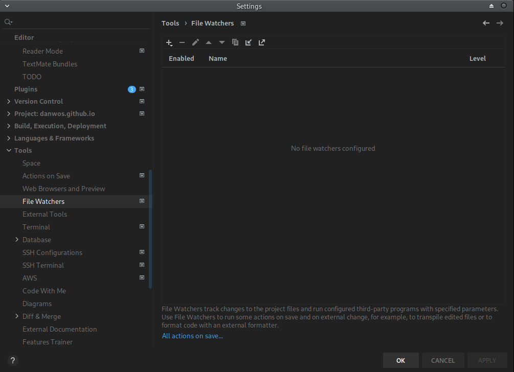
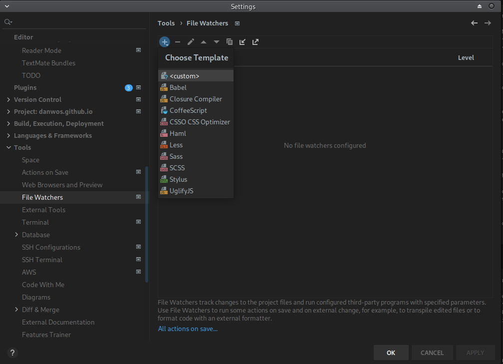
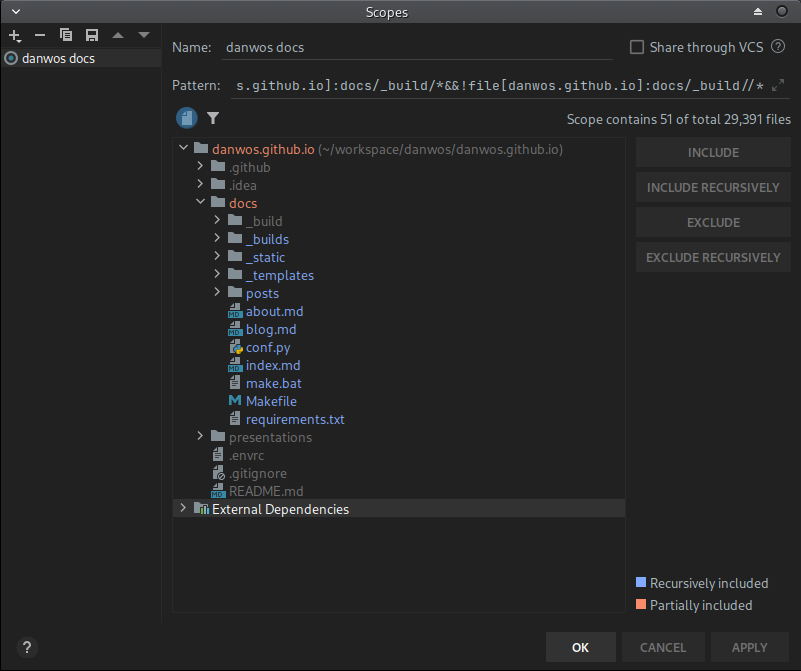
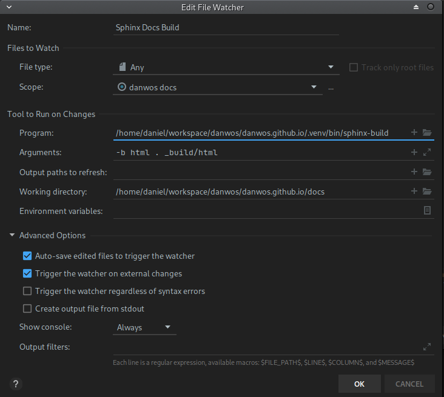
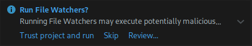

I often want to see my documentation as fast as possible.

I know there are preview extensions for IDEs that try to solve this problem. But they all have one of the following problems:

- They often support standard rst syntax only, so no Sphinx extensions.
- Their preview window can't be placed the way I need it.
- They often force a full build, because their build command differs from the one I normally use.
- I need to see the result in a normal browser window, with the option to debug the site (e.g. to check CSS).

So I came up with a solution: the built-in file watcher feature of PyCharm.

Open *File → Settings → File Watchers*.

Create a new watcher (plus sign) and select `<custom>`.

Set `File Type` to `All`.

Configure the project `scope`. It defines when your watcher gets triggered.

Select your `docs` folder and press `Include recursively`.

Then select the `_build` folder inside `docs` and exclude it with `Exclude recursively`. This step is important: otherwise the file watcher hangs in a loop, because it changes files under `_build`, which would trigger the watcher again.

Back to the file watcher configuration.

For `Program`, select the `sphinx-build` command from your Python environment.

Set the arguments to `-b html . _build/html` and the `Working Directory` to the `docs/` folder.

Under `Advanced Options`, select `Always` for `Show console`. This shows you the result of each build.

After saving the configuration with `OK`, a small popup in the bottom right corner asks you to trust the project's file watchers.

That's it. You still need to open the generated page in your browser by hand, of course.
