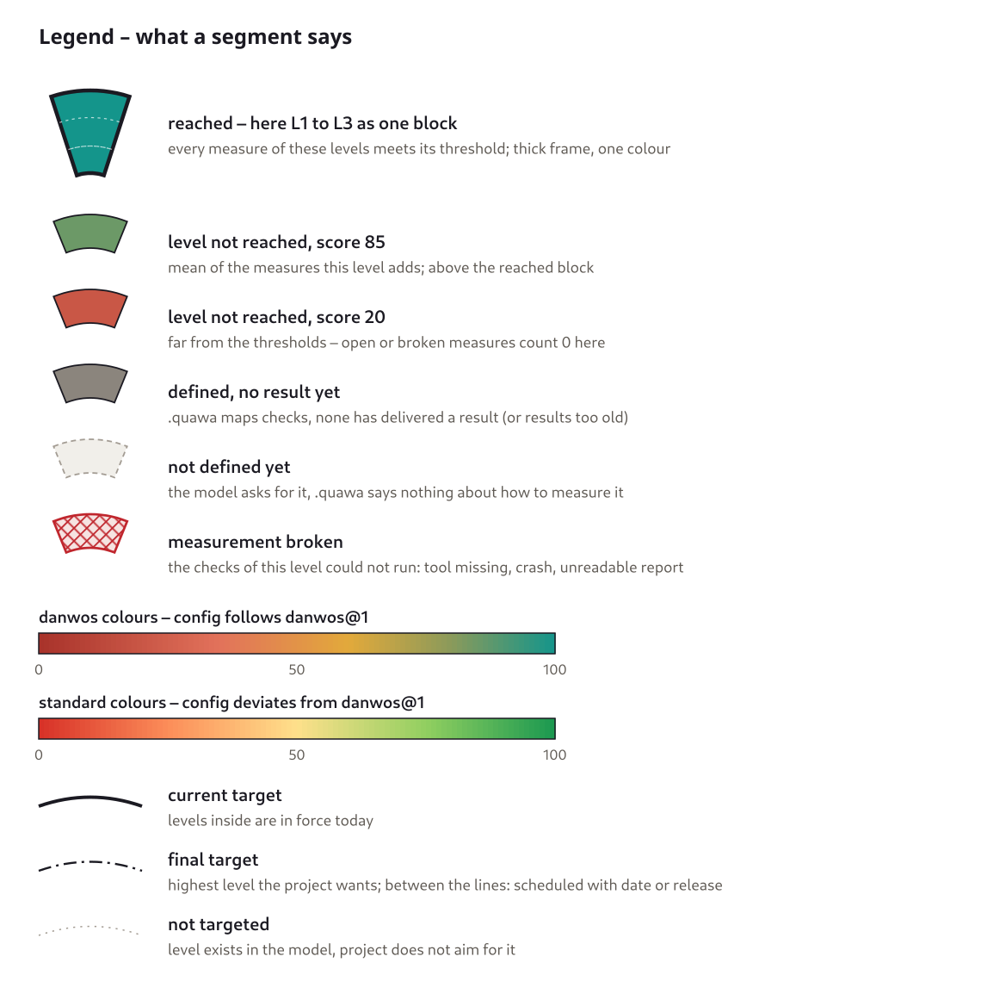
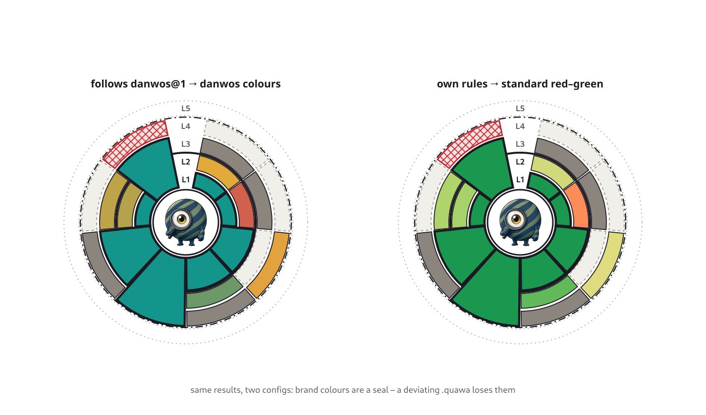
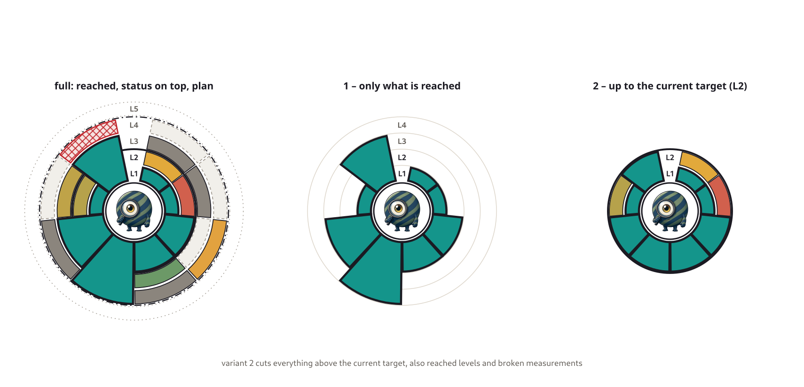

A sculptor always sees where the figure is still rough. With software, I don't. A feature an AI built in an hour looks finished. The tests are green. And still I don't know whether someone else can build on it yet, whether the licenses of the dependencies are fine, or whether the tests check anything at all.

If you build [like a sculptor](/en/blog/sculpting-software/) – the whole thing roughly first, then finer round by round – you need a view that the classic build doesn't give you.

## Green and red are not enough

Most quality checks know two states: passed or not. That works when a product is supposed to be finished. At the start of a tool, though, almost everything is red. There are no integration tests yet, no architecture docs, no license check – and that's perfectly fine, because nobody asks for that in week two.

A red signal everyone expects anyway gets ignored after three days. Or the check gets switched off until "it's time". Both mean: I no longer see where I stand.

So I want to measure everything, always – including what nobody asks for today. A gap is information, not a broken build. What counts is the distance to the target I set for now – and how it changes over time.

## Five maturity levels

Single tests aren't enough for that. In the end I have hundreds of results – unit tests, licenses, linting, docs, security – and none of them tells me how far the tool is as a whole. Levels sum all of that up in one statement: "Documentation is at 1, security at 4."

Levels also show that I don't need everything at once. An early tool only needs the first one; the next ones come when it's their turn. At the same time they push me to really finish a level – with all its details – instead of tinkering with the next one while there are still gaps below.

The levels describe a state, not a work step:

| Level | State |
|---|---|
| 0 Vibe code | whatever is there |
| 1 Sketched | roughly there – you can see what it will be |
| 2 Shaped | the form stands and holds |
| 3 Solid | carries load, ready for real users |
| 4 Refined | worked through in detail, the hard parts too |
| 5 Audited | confirmed from outside |

On purpose, it doesn't say "tested" or "documented". Every area fills a level with its own measures. For testing, "Solid" means: integration and end-to-end tests run. For licenses it means: all dependencies are checked against my rules. A word like "tested" would only fit one of the two.

Eight areas share the picture: requirements, documentation, testing, code health, security, legal, product and UX, and build and release. Every level adds new measures per area, and a level only counts as reached when all levels below are met too.

## Where it stands at a glance

This is how it could look for quawa – the tool that will draw these rings. The values are an invented example, not a real measurement – they show every state at once. The tool sits in the middle, around it one ring per level, from the inside out. Every slice of the pie is an area.

- **The thick block** from the center outwards shows what is reached. Security is at level 4, legal at 3, documentation only at 1. The picture gets hills and valleys, and I see right away where the tool is weak.
- **Above it**, every further level shows its own state: red when the measures are far off, orange when it gets close. Levels far above the target are measured too – the mutation tests on level 4 already run, even though something is still missing on level 3.
- **Gray** shows what has already been thought of. Dark gray means the measure is defined but there is no result yet. Light gray and dashed means the model asks for something, but the project doesn't say yet how to measure it. Red hatching means the measurement itself is broken.
- **The lines** show the target: the thick line marks what applies today, the dashed one where the project wants to end up. What lies in between is planned – with a date or a release: "level 3 from March 2027, level 4 from version 1.0". Level 5 isn't planned for quawa at all and stays a dotted outline.

So one picture answers three questions: Where does the tool stand? Where does it want to go? And what have I already thought about?

## Staying comparable

Every project decides how it measures. If it could also decide *what* is measured on which level, every tool would have its own "level 3" – and the rings of two tools couldn't be compared anymore.

That's why there is a fixed danwos model. It decides what is measured from which level on, for example linting and unit tests from level 2. The project only says *where* the measurements come from: which test run, which report, which tool. It may be stricter, it may add its own measures. Weaker, no.

If you stick to it, you get the danwos colors – terracotta to teal. If you deviate, you get a plain red–green. The color becomes a small seal: it shows the levels were reached under the same rules.

## Sometimes less is more

There isn't room for the whole picture everywhere. For a card or a badge in the README there are two slim variants. One shows only what is reached – the hills and valleys. The other shows everything up to today's target and cuts off the rest. It answers the question: What do I owe today?

## No green check marks without substance

As soon as AI agents work towards green rings, they write tests that check nothing and documentation that merely exists. That's why checks that uncover exactly this belong in the model: mutation tests show whether tests really test, and AI-assisted ratings show whether the docs cover every feature. Both sit on the higher levels – and are measured from the start anyway.

## What's next

The model moves into [quawa](/en/tools/quawa/). For each repository, quawa reads where the measurements come from and which level applies from when, runs the checks and draws the rings. The first tool to be measured this way is [deciwa](/en/tools/deciwa/) – it's public, so everyone should be able to see how mature it is. Then come quawa itself – a tool that measures maturity should be able to show its own – and monsterbrain.
