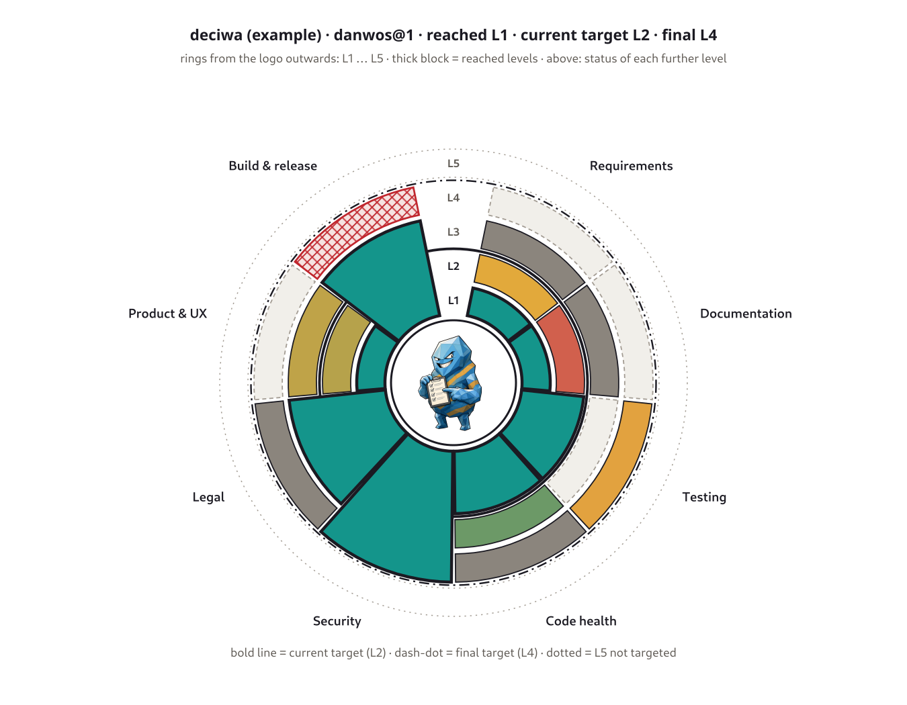

import Scene from '../../../components/Scene.astro';
import Screens from '../../../components/Screens.astro';
import StatusDemo from '../../../components/StatusDemo.astro';
import ToolLinks from '../../../components/ToolLinks.astro';
import QualityRoll from '../../../components/QualityRoll.astro';
import QualityNetwork from '../../../components/QualityNetwork.astro';
import city from '../../../assets/tools/horus/city.png';
import select from '../../../assets/tools/horus/select.png';
import problems from '../../../assets/tools/horus/problems.png';

## Ein Pull Request, viele Blicke

Für einen Developer ist ein Pull Request vor allem Code und grüne Tests.
Für mich hängt daran viel mehr: das Feature selbst, UI und UX, die Docs, die
Marketing-Farben, Codequalität und Wartbarkeit, wie tief und wie gut die
Tests wirklich sind, ob die Requirements eingehalten werden oder sich schon
leise davon entfernen – und noch einiges mehr.

Das alles einfach und schnell erfassbar zu zeigen, ist eine
Herausforderung. Für einen einzelnen Pull Request reichen Dashboards und
Kommentare. Will ich aber Dutzende Pull Requests im ganzen Produkt im Blick
behalten, wird es schwer. Dann bleiben Dashboards für einzelne Checks – aber
nie alles auf einmal.

## Die Nadel im Heuhaufen

Am Ende suche ich die Nadel im Heuhaufen. Und die sieht für jede Rolle
anders aus:

| Rolle | Die Nadel |
|---|---|
| Developer | der eine rote Test zwischen hundert grünen |
| Projektleitung | das Feature, das seit Tagen hängt |
| Test | die Änderung, die kaum getestet ist |
| Kunden | die Anforderung, die nicht umgesetzt wurde |
| Marketing | die falsche Farbe im neuen Screen |
| Legal | die neue Lizenz in den Abhängigkeiten |
| Controlling | der Aufwand, der aus dem Ruder läuft |

## Lesen ist langsam

Ich glaube, Wörter zu lesen ist eine der schlechteren Arten, eine Situation
zu erfassen. Stehen bei hundert Pull Requests „ok“, „in progress“, „backlog“
und „cancelled“ in der Statusspalte, ist die eine Zeile mit „failure“ schwer
zu finden. In Farbe oder als Icon springt sie sofort ins Auge.

<StatusDemo lang="de" />

## Spüren statt lesen

Daraus ist mein Motiv entstanden: Probleme sollen sich intuitiv erfahren und
erspüren lassen. Ich will nicht lesen müssen, um eine Situation zu erfassen.

Neben Text zählen deshalb vor allem visuelle Reize – Farben, Formen und
Strukturen. Bei großen Datenmengen hilft auch Tiefe: ein Raum in 3D statt
flachem Text in einer Tabelle. Töne könnten ebenfalls eine wichtige Rolle
spielen. Im Büroalltag lassen sie sich aber nur schwer in die Workflows
einbauen.

## Muster, die jeder kennt

Für die Darstellung greife ich gern auf Ideen und Konzepte zurück, die es
schon gibt, weil sie intuitiv verstanden werden. Fast jeder kann eine
Straßenkarte lesen und ihre Strukturen und Farben deuten: breite Straßen,
dichte Städte, leeres Land dazwischen. Überträgt man diese Darstellung auf
andere Daten, bekommt man schnell einen Einblick in ein Thema.

Mit [Horus](/de/tools/horus/) habe ich das spielerisch an echten
Sphinx-Needs-Daten ausprobiert. Die Needs stehen als leuchtende Stadt im
Raum: jede Gruppe ein Turm, jeder Need ein Stockwerk, die Farbe zeigt den
Status. Verstöße gegen das Schema leuchten rot – man sieht sie von weitem,
ohne eine Zeile zu lesen.

<Screens images={[
  { src: city, alt: "Die Sphinx-Needs-Demo als Stadt: ein Turm pro Need-Typ, die Stockwerke leuchten in der Farbe ihres Status." },
  { src: select, alt: "Ein ausgewählter Need mit Inhalt und Links, die als Bögen zu anderen Türmen laufen." },
  { src: problems, alt: "Schemaverstöße: Einzelne Stockwerke im Turm der funktionalen Sicherheitsanforderungen leuchten rot." },
]} />

Video und Erklärungen, wie Horus funktioniert, findest du auf der
[Tool-Seite von Horus](/de/tools/horus/).

## Was Science-Fiction schon wusste

<Scene monster="danwos-grid" wide alt="Das danwos-Monster steht staunend in einem 3D-Gitter, um es herum schweben vernetzte Objekte" />

Ein starker Ideengeber sind für mich die Computer-Interfaces aus
Science-Fiction-Filmen und -Serien. Sei es das farbige 2D-Layout der
Konsolen in Star Trek oder die 3D-Netzwerke, in denen die Computerhirne der
Androiden in „Ghost in the Shell“ denken.

Oft sind die Ideen ganz schön abwegig – und tauchen erstaunlich früh auf. Im
Klassiker „Hackers“ von 1995 ragen Dateien als 3D-Türme auf, und ein Virus
läuft als Krümelmonster über den Bildschirm.

Heute liefert AI Daten in Mengen, die Menschen prüfen, kontrollieren und
freigeben müssen. Da muss jede Idee willkommen sein, egal wie sehr sie mit
dem aktuellen Stand bricht.

## Ein Pull Request zum Drehen

Wie das aussehen kann, zeigt ein kleiner Versuch: ein Pull Request als
Rolle. Jede Scheibe ist ein Qualitätskriterium – Tests, Docs,
Requirements, Legal und mehr. Jede Scheibe ist wieder in Tortenstücke
geteilt, bei den Tests etwa in Unit, Integration und System. Die Farbe
zeigt, wie gut es um jedes Stück steht.

Von außen siehst du auf einen Blick, ob irgendwo etwas rot leuchtet. Erst
wenn du genauer hinschauen willst, ziehst du die Rolle auseinander und
liest, was dahinter steckt.

<QualityRoll lang="de" />

## Dutzende Pull Requests auf einmal

Eine Rolle hilft bei einem Pull Request. Spannend wird es bei Dutzenden.
Hier stehen 48 Pull Requests aus vier Schichten eines Produkts im Raum –
App, Service, Bibliothek und Plattform –, verbunden dort, wo einer vom
anderen abhängt. Die meisten sind grün. Wo es rot und orange wird, siehst du
sofort, auch zwischen allen anderen. Ein Klick holt dir die Rolle heran.

<QualityNetwork lang="de" />

## Wie reif ist ein Tool?

Was für einen Pull Request gilt, gilt auch für ein ganzes Tool. Statt
Hunderter Prüfergebnisse zeigt ein Bild, wie reif es ist: um das Logo ein
Ring pro Reifegrad, ein Tortenstück pro Bereich. Der dicke Block zeigt, was
erreicht ist, darüber steht, was gerade schiefläuft, und grau, woran schon
gedacht ist.

Noch eine Idee – wie sie funktioniert, steht in
[Wie roh ist deine Software?](/de/blog/quality-maturity/).

## Arbeiten in den Daten

<Scene monster="danwos-vr" left wide alt="Das danwos-Monster liegt mit VR-Brille auf einer geschwungenen Liege, links die Tastatur, rechts die Maus, und arbeitet" />

Virtual-Reality-Brillen könnten diese neue Welt tragen, und mit ihnen andere
Modelle für Schreibtisch und Arbeitsplatz. Statt Tabellen auf zwei
Bildschirmen liegt das Projekt dann als Raum um dich herum – und das Problem
leuchtet dort, wo es ist.

## Tools für Views und Visualisierung

Einiges davon habe ich schon gebaut. Horus ist die Stadt aus Needs.
Sphinx-Preview zeigt beim Überfahren eines Links, was dahinter steckt, ohne
die Seite zu wechseln. Sphinx-Data-Viewer macht aus großen JSON-Daten einen
Baum, den du nur so weit aufklappst, wie du ihn brauchst.

<ToolLinks lang="de" tools={['horus', 'sphinx-preview', 'sphinx-data-viewer']} />
